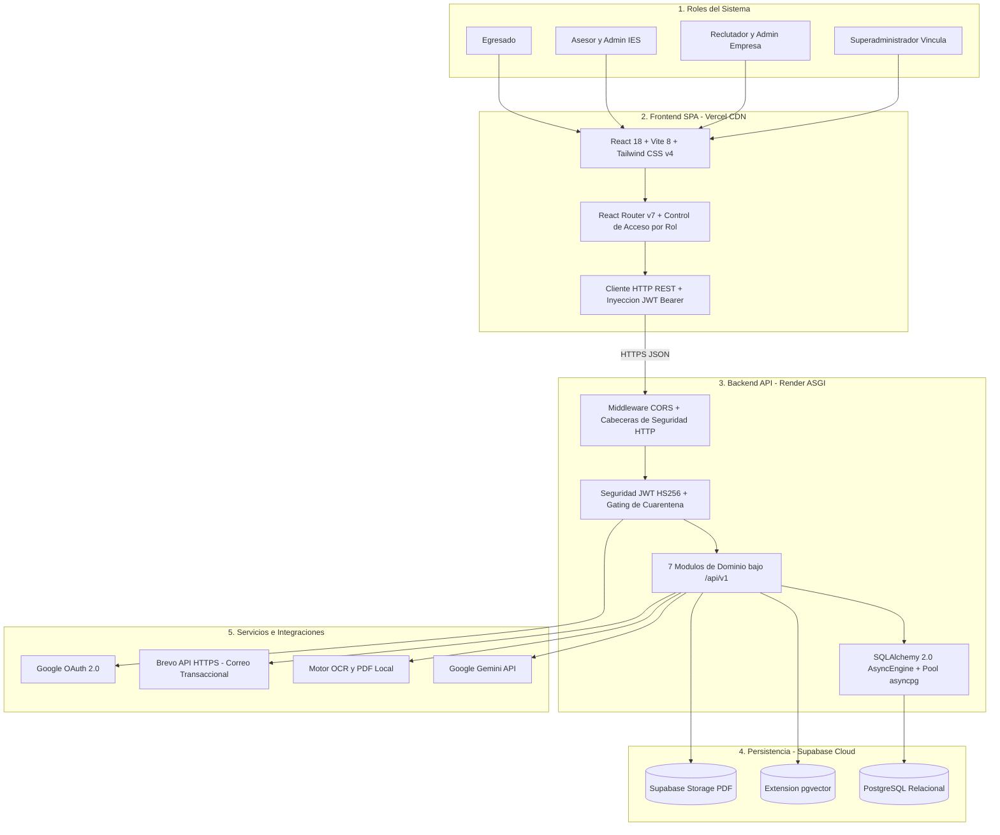
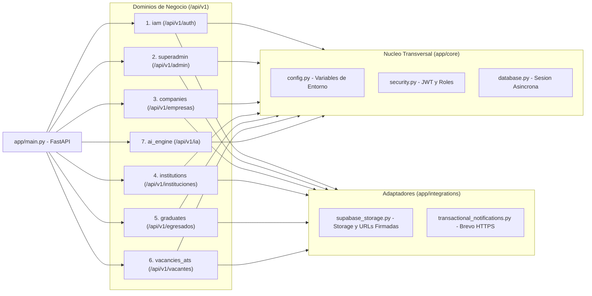
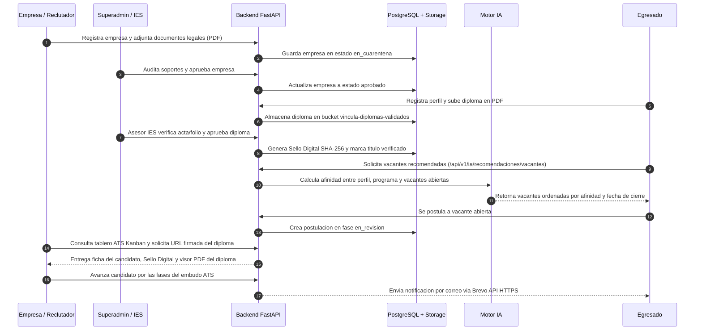

# Arquitectura de Software — Plataforma Vincula

**Vincula** implementa una arquitectura de **Monolito Modular Híbrido Asíncrono** dividida en cuatro niveles desacoplados:

1. **Capa de Presentación (Frontend SPA):** React 18, Vite 8, React Router v7 y Tailwind CSS v4 (desplegada en Vercel).
2. **Capa de Aplicación (Backend API):** FastAPI, Uvicorn ASGI y SQLAlchemy 2.0 Async con Gating de Cuarentena y 7 dominios modulares bajo `/api/v1` (desplegada en Render).
3. **Capa de Persistencia:** PostgreSQL 15+, extensión vectorial `pgvector` y buckets privados en Supabase Storage.
4. **Capa de Procesamiento e Integraciones:** Google Gemini API, Google OAuth 2.0, Motor OCR/PDF local (PyPDF + RapidOCR + ReportLab) y correo transaccional vía Brevo API HTTPS.

---

## 1. Vista General de Capas e Infraestructura

---

## 2. Arquitectura Interna del Backend (7 Dominios Modulares)

Cada dominio en `backend/app/modules` encapsula sus propios archivos `router.py`, `services.py`, `schemas.py` y `models.py`.

### Responsabilidad de cada módulo

| Módulo | Prefijo API | Responsabilidad Principal |
| :--- | :--- | :--- |
| **1. `iam`** | `/api/v1/auth` | Autenticación JWT, login con Google OAuth 2.0, registro multirrol, sesiones y recuperación de contraseña. |
| **2. `superadmin`** | `/api/v1/admin` | Auditoría legal de 72h, aprobación o subsanación de empresas e instituciones y analítica global. |
| **3. `companies`** | `/api/v1/empresas` | Perfil corporativo, sedes, equipo de reclutadores, convenios con IES y bitácora de actividad. |
| **4. `institutions`** | `/api/v1/instituciones` | Sedes IES, facultades, programas SNIES, extracción OCR de pensums y validación de diplomas con Sello Digital SHA-256. |
| **5. `graduates`** | `/api/v1/egresados` | Hoja de vida integral, soporte de diploma PDF, idiomas, experiencia, privacidad y seguimiento de postulaciones. |
| **6. `vacancies_ats`** | `/api/v1/vacantes` y `/api/v1/reclutador` | Publicación de vacantes con Gating de Cuarentena, tablero ATS Kanban de 6 fases, entrevistas y visor de diplomas para reclutadores. |
| **7. `ai_engine`** | `/api/v1/ia` | Recomendación híbrida de vacantes (TF-IDF + competencias), asistente de carrera con RAG y trazabilidad curricular frente al mercado laboral. |

---

## 3. Flujo de Seguridad, Validación Académica y Selección ATS

