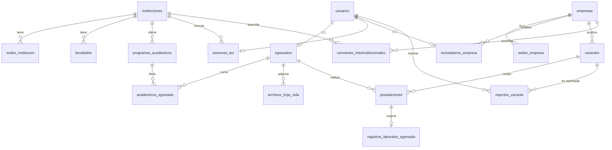
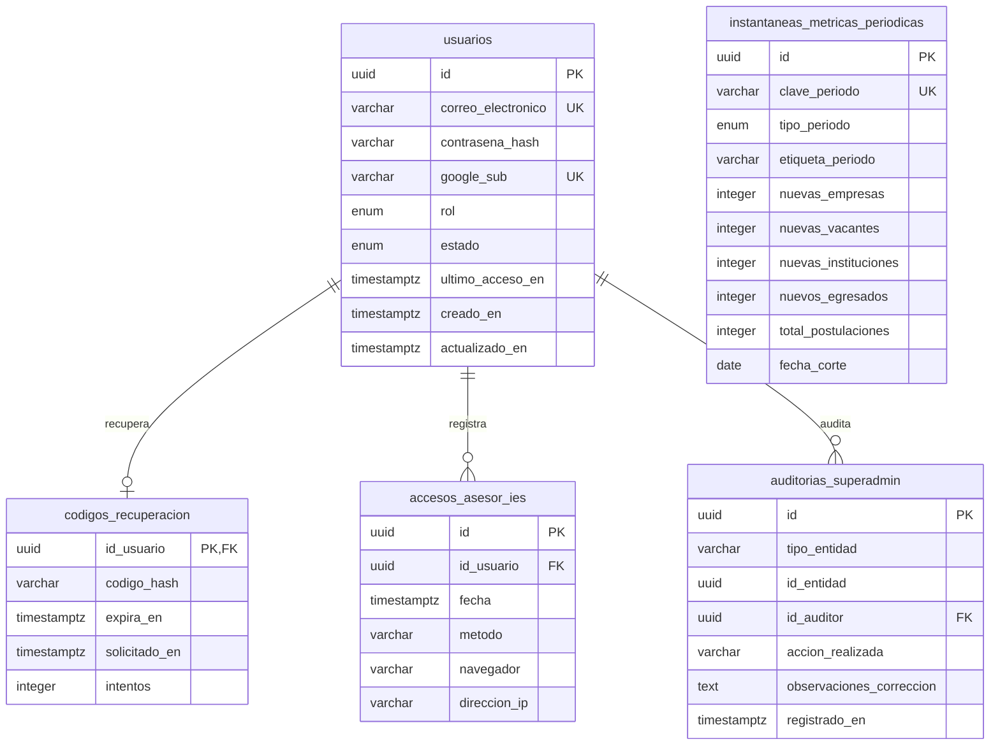
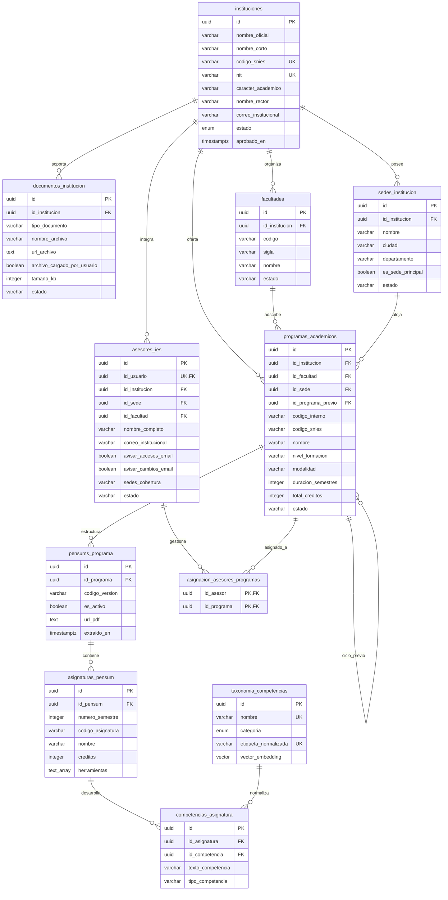
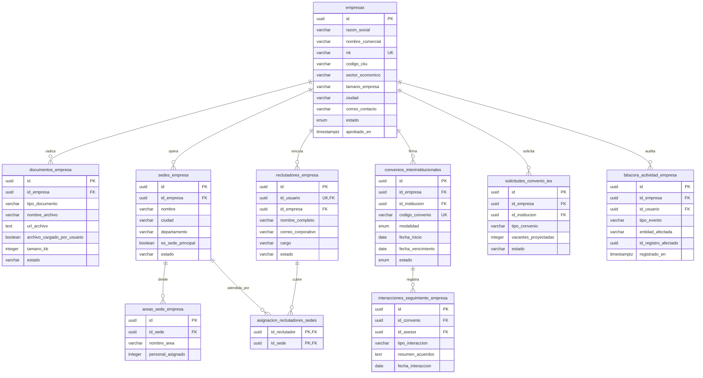
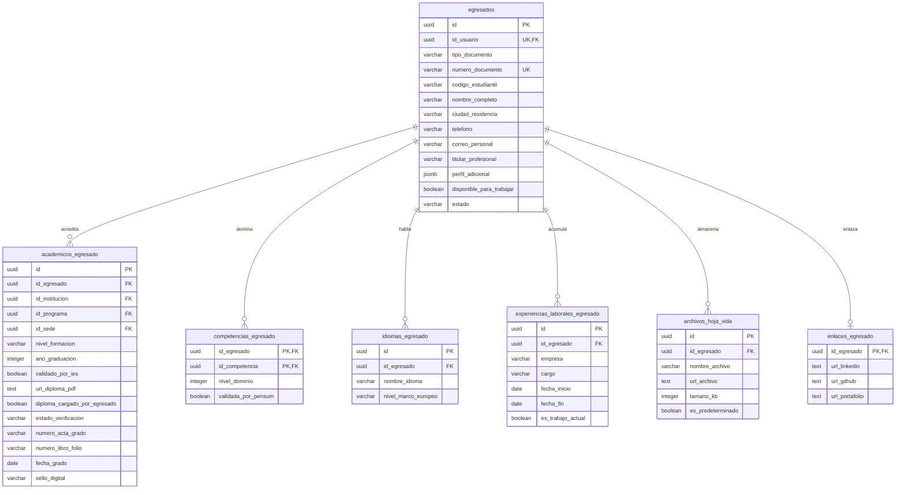
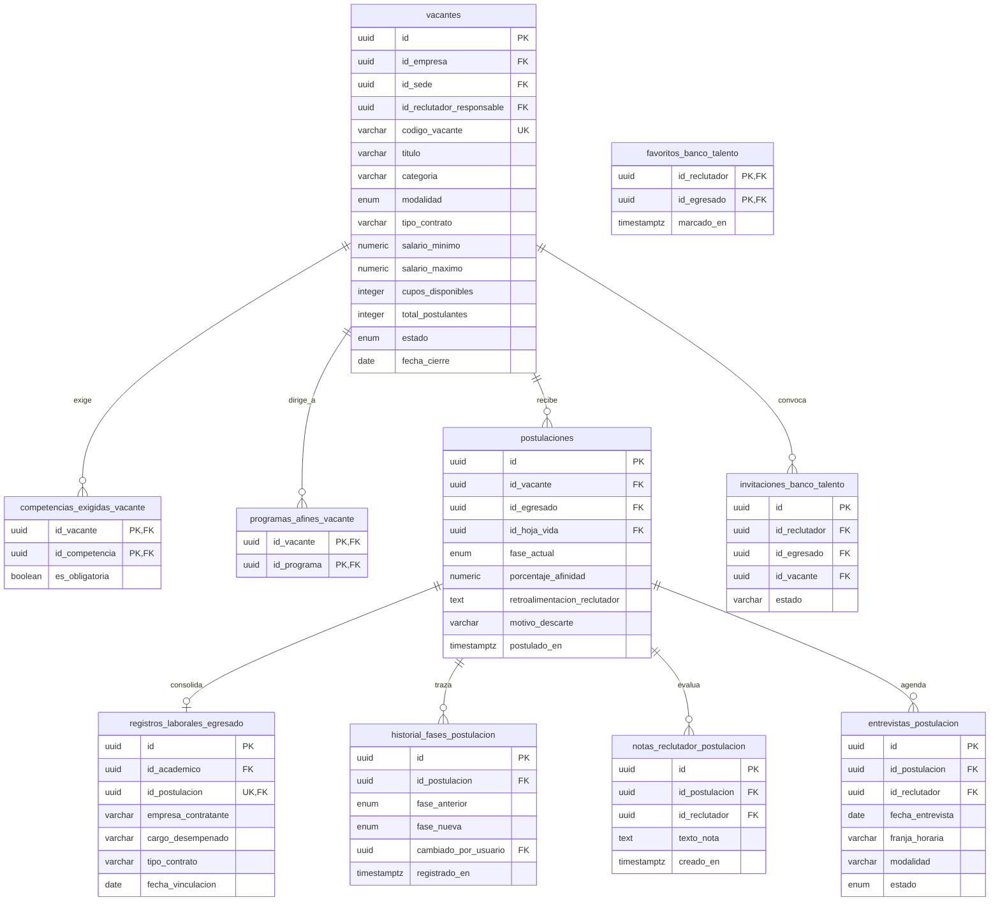
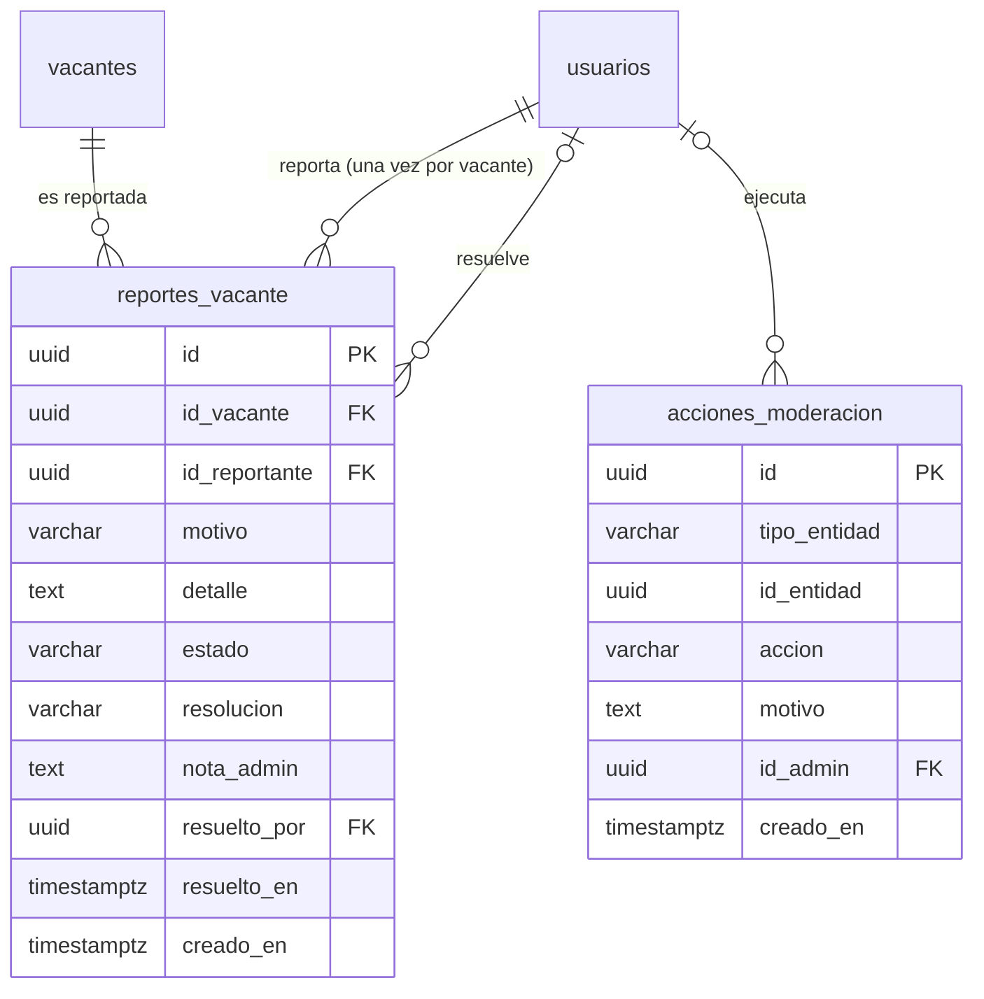

# Diagrama de Base de Datos (ERD) — Plataforma Vincula

Este documento presenta el modelo Entidad-Relación completo de las **45 tablas** definidas en [schema_vincula_completo.sql](file:///u:/Bolsa_de_empleo/database/schema_vincula_completo.sql) (PostgreSQL 15+ y `pgvector`). Para evitar cruces de líneas y superposición de textos, el modelo se presenta en una **Vista Macro** seguida de **6 diagramas detallados por dominio**.

---

## 1. Vista Macro — Relaciones entre Entidades Principales



---

## 2. Dominio 1 — Identidad, Acceso (IAM) y Auditoría Global

Tablas: `usuarios`, `codigos_recuperacion`, `accesos_asesor_ies`, `auditorias_superadmin`, `instantaneas_metricas_periodicas`.



---

## 3. Dominio 2 — Ecosistema Académico (IES, Programas y Pensum)

Tablas: `instituciones`, `documentos_institucion`, `sedes_institucion`, `facultades`, `programas_academicos`, `pensums_programa`, `asignaturas_pensum`, `competencias_asignatura`, `taxonomia_competencias`, `asesores_ies`, `asignacion_asesores_programas`.



---

## 4. Dominio 3 — Ecosistema Empresarial y Convenios IES

Tablas: `empresas`, `documentos_empresa`, `sedes_empresa`, `areas_sede_empresa`, `reclutadores_empresa`, `asignacion_reclutadores_sedes`, `convenios_interinstitucionales`, `solicitudes_convenio_ies`, `interacciones_seguimiento_empresa`, `bitacora_actividad_empresa`.



---

## 5. Dominio 4 — Egresados, Expediente Académico y Hoja de Vida

Tablas: `egresados`, `academicos_egresado`, `competencias_egresado`, `idiomas_egresado`, `experiencias_laborales_egresado`, `archivos_hoja_vida`, `enlaces_egresado`.



---

## 6. Dominio 5 — Vacantes, Embudo ATS Kanban y Banco de Talento

Tablas: `vacantes`, `competencias_exigidas_vacante`, `programas_afines_vacante`, `postulaciones`, `registros_laborales_egresado`, `historial_fases_postulacion`, `notas_reclutador_postulacion`, `entrevistas_postulacion`, `favoritos_banco_talento`, `invitaciones_banco_talento`.



---

## 7. Dominio 6 — Moderación de Vacantes y Cuentas

Tablas: `reportes_vacante`, `acciones_moderacion` (y el estado `inhabilitada` de `vacantes.estado`).



`acciones_moderacion.id_entidad` apunta, según `tipo_entidad`, a una vacante, un usuario o una empresa (referencia polimórfica sin clave foránea). La tabla `auditorias_superadmin` no se reutiliza porque su restricción solo admite `empresa` e `institucion`.

---

## 8. Cómo mantener el SQL y el diagrama iguales a la base de datos desplegada

La fuente de verdad es la base de datos desplegada; el SQL del repositorio es su copia legible. Cada vez que se aplique una migración (`database/*.sql`):

1. Reflejar el cambio en `schema_vincula_completo.sql` (y en este documento si cambian tablas o relaciones).
2. Verificar que no haya deriva, desde `backend/`:

```bash
python scripts/schema_tools.py check
```

Compara tablas, columnas y valores de enums contra la BD real y termina con código 1 si hay diferencias.

3. Regenerar el diagrama MER interactivo (DBML) desde la BD real:

```bash
python scripts/schema_tools.py dbml
```

Esto escribe `docs/diagrama_bd.dbml`. Se pega en [dbdiagram.io](https://dbdiagram.io) para verlo, reordenarlo y exportarlo a PNG o PDF.

Alternativas con conexión directa a la BD: DBeaver (clic derecho en el esquema → *View Diagram*) y pgAdmin (*Generate ERD*).
